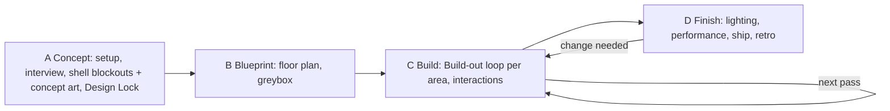

# Agentic VRChat World Development Kit (AWDK)

A kit that lets a coding agent build a polished **VRChat world** in Unity from a conversation:
a staged pipeline with visual review gates, specialised subagents, skills, a Unity Editor tools
package and several hundred single-lesson notes learned on real worlds. Everything is plain Markdown
with YAML front matter, so any agent host can use it: Claude Code, Codex, Gemini CLI, Cursor,
oh-my-pi and others.

Stack: Unity 2022.3.22f1, VRChat Worlds SDK (VCC / ALCOM / vrc-get), UdonSharp, Built-in Render
Pipeline, PC first (optional Android/iOS port). Optional: Bakery, Blender. The agent drives the open
Editor through [MCP for Unity](https://github.com/CoplayDev/unity-mcp).

## Pipeline



You decide the concept and style up front and the final upload; agents build the rest. Every
design and build stage ends at a reviewer agent's verdict (layout, dressing, final), and
performance at measured budgets. Details: [skills/world-pipeline/SKILL.md](skills/world-pipeline/SKILL.md).

## Quick start

1. Clone this repo as `.omp/` inside the folder that holds your Unity projects:
   `git clone <repo-url> <workspace>/.omp`
2. Copy `local.example/` to `local/` and fill in `local/config.md` (your paths and GPU). `local/` is
   ignored by git; your personal setup never ends up in the repo.
3. Wire your agent host ([docs/hosts.md](docs/hosts.md)):
   - oh-my-pi: nothing to do, it reads `.omp/` directly.
   - Claude Code: `python .omp/scripts/install.py --host claude`
   - Codex, Gemini CLI and other `AGENTS.md` / `.agents/skills` hosts: `python .omp/scripts/install.py --host agents`
4. Set up Unity, the VRChat SDK, MCP for Unity, the tools package, the lightmapper and your
   generation tools (paid services first, free local fallbacks; [docs/tools.md](docs/tools.md)):
   point your agent at [docs/bootstrap.md](docs/bootstrap.md).
5. Tell your agent: **"Make me a world."**

## Layout

```
AGENTS.md          entry point: hard rules, world standards, routing table
skills/            world-pipeline plus Unity / VRChat / Udon / lighting / optimisation / asset skills
agents/            subagent prompts: world-architect, world-builder, asset-finder, blender-modeler,
                   blender-optimizer, layout-, dressing- and final-reviewer, perf-optimizer
knowledge/         single-lesson notes (symptom -> cause -> fix -> verify) + INDEX.md
docs/              bootstrap, hosts, new world, Unity tools, troubleshooting
templates/         WORLD.template.md, the per-world brief
unity-package/     com.awdk.agenttools: z-fight scan, captures, perf sampling, world audit
scripts/           host installer, MCP helpers, perf grading, kit checks
local.example/     template for your personal layer (local/, never committed)
```

## Updating and contributing

Pull to update. If you change the kit, enable the leak check once
(`git -C .omp config core.hooksPath .githooks`): commits that add a term from your
`local/banned-terms.txt` are refused. `python .omp/scripts/check_kit.py` checks links, front matter
and host-neutral syntax.

## Licence

Free for personal and other noncommercial use; the kit itself may not be sold. **Worlds and assets
you make with it are yours, including for sale** ([LICENSE.md](LICENSE.md), Output Exception).
Software: PolyForm Noncommercial 1.0.0 ([LICENSE-CODE.md](LICENSE-CODE.md)); everything else:
CC BY-NC-SA 4.0 ([LICENSE-DOCS.txt](LICENSE-DOCS.txt)). Third-party skills keep their own licences.
Source-available, not OSI open source.

## Credits

Every external source is listed in [CREDITS.md](CREDITS.md) and cited where used. The kit's structure
is inspired by [Atelier](https://github.com/Ryan6-VRC/atelier) by Ryan6-VRC.
