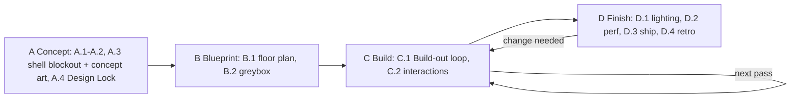
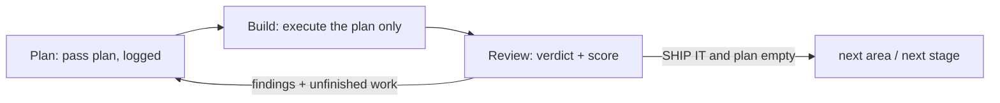

# VRChat world pipeline

You are the **orchestrator**. You talk to the user, own `WORLD.md`, run every stage in order,
dispatch builders and reviewers, and stop where the user asked to decide. Subagents cannot ask
the user anything, so every question to the user comes from you.

Goal: information gathering and the concept (a style track of text → image concept art and style
rounds, and a layout track of shell blockouts shown as plain captures) lock the world's style, shells, purpose and targets; after that, agents build
the whole world to the end. The user decides the concept and style (up front) and the final upload.

| Phase | Stages | Who decides |
|---|---|---|
| **A · Concept** | A.1 Setup · A.2 Information gathering · A.3 Concept (shell layout + concept art) · A.4 Design Lock | the user |
| **B · Blueprint** | B.1 Floor plan · B.2 Greybox | agents (one optional user review, on in "Every step") |
| **C · Build** | C.1 Build-out (the main loop) · C.2 Interactions & playability | agents |
| **D · Finish** | D.1 Lighting · D.2 Performance · D.3 Ship · D.4 Retro; loops back to C | agents, then the user uploads |

A stylistic choice the lock did not settle is a **lock gap** ("Lock gaps" below): a missing
information-gathering question.

## Files

Paths written as `.omp/...` resolve from the workspace root (`<workspace>`); Markdown links
resolve from the file that contains them.

| File | Purpose |
|---|---|
| `<project>/WORLD.md` | The brief, the involvement settings, the Design Lock table, the shell layout, floor plan and greybox pick, the prop schedule, the Build-out area tracker, decisions log, lock gaps, stage status. Single source of truth. Template: [.omp/templates/WORLD.template.md](../../templates/WORLD.template.md) |
| `<project>/Design/lock/` | Every image the user approved for the lock, plus `lock.json` (captions, tags, feel lines). The feel target every builder and reviewer works to |
| `<project>/Design/concepts/genNN-<route>/` | A.3 images only, **one folder per generation** (route `text`, `3d` or `style`): `<letter>_<view>.png` (3D route: plain Unity captures, no paint-overs). This is the only folder the user looks at |
| `<project>/Design/_prompts/genNN-<route>/` | Agent-only: the prompt files, pitches and notes for the matching generation. Never shown to the user; pitches are summarised in chat |
| `<project>/Design/layout/` | A.3 shell layouts as data (`vN.json`: building and tree volumes, levels, bridges and paths, ground/water, spawn, extent); the picked one is also the scene root `SHELL_PICK` |
| `<project>/Design/plans/` | B.1 floor plans inside the locked shells (`vN.png` + `vN.json`); after the B.2 pick the plan JSON also holds the `furniture` placeholder list |
| [references/intake.md](references/intake.md) | Information gathering: the checklist of required facts, extraction from what the user supplied, gap questions, concept rounds, defaults, involvement, lock-gap questions |
| [spatial-design](../spatial-design/SKILL.md) | Architecture and interior-design guide (`references/spatial-design.md`): space archetypes, massing, per-archetype rules, intimacy gradient, checklists for architect and reviewers; plus the sourced research and the case studies behind it |
| [clip-planes](../clip-planes/SKILL.md) | Clip planes, fog vs the far cut, float precision and world extent (256/512 m radii), teleport-island placement, distant scenery, z-fight separation; setup checklist |
| [references/review-protocol.md](references/review-protocol.md) | Shared rules for all reviewers: capture, verdict and score, images as feel references, judging against the lock, reviewers by stage, trial logging |
| [pipeline-trial](../pipeline-trial/SKILL.md) | Trial runs: checkpoint after every stage, `Trial/log.jsonl` event log, HTML/PDF reports, agreement rate |
| `ZFightScan`, `WorldCapture`, `ZFightRender`, `PerfSample`, `WorldAudit` | Editor package `com.awdk.agenttools` ([.omp/docs/unity-tools.md](../../docs/unity-tools.md)); the checks every gate uses |

## Agents

| Agent | Role | Stages | Mutates |
|---|---|---|---|
| `world-architect` | World kind and optional VIP island; A.3 concepts: text → image style concept art (style track) and shell-layout blockouts in a scratch area of the open scene shown as plain captures (layout track), a pitch per option, then the text → image style rounds; B.1 floor plans inside the locked shells (room purposes, no furniture); B.2 greybox variants (massing plus big-furniture placeholders); the placeholder export after the pick | A.3, B.1, B.2 | Scratch roots / shell and greybox only |
| `world-builder` | Executes one pass of a build stage in Unity: Build-out areas, interactions and colliders, lighting | C.1, C.2, D.1 | Scene, within the pass's scope |
| `asset-finder` | Finds existing models and materials as each Build-out pass needs them, before anything is modelled | C.1 | No |
| `blender-modeler` | Models custom props and architecture pieces | C.1 | Blender + exports |
| `layout-reviewer` | Ranks A.3 shell layouts (structure, massing, scale vs the reference eye height, world extent, divergence), B.1 floor plans and B.2 greybox variants with their furniture placement in 3D from eye height, plus world size limits; signs off the refined greybox | A.3, B.1, B.2 | No |
| `dressing-reviewer` | Each Build-out pass and the placed interaction objects: build quality and board match, with separate **style** and **build** scores; decides lock gaps; never lighting | C.1, C.2 | No |
| `final-reviewer` | Lighting incl. mood against the boards, final render; the only upload gate; visual regressions after perf fixes | D.1, D.2 | No |
| `perf-optimizer` | Play-mode measurement, per-system cost attribution, reversible fixes with proof | D.2 | Scene (reversible fixes) |

A.3 style rounds and text-route images have no reviewer: the user is the style judge. There is no separate style reviewer;
its work is split between world-architect's pitches, the user's picks, dressing-reviewer's
board-match criterion and final-reviewer's mood check.

**Unity is one shared editor.** Never run two mutating agents at once. Reviewers may run while
nothing mutates. Read-only agents (asset-finder, image work) can run alongside a builder.

## Decisions and involvement

Ask the involvement preset at the end of information gathering and store it in WORLD.md. Every
decision is either `user` (stop and ask, with options, the reviewer's scores and ranking and your
recommendation) or `agent` (the top-scored option is taken, logged and reported in the next
message). The user can change the setting at any time ("from now on just go").

| Preset | User decides |
|---|---|
| **Design lock, then autopilot** (default) | A.2 (answers to gaps), A.3 concept pick (layout + look) and each style round, A.4 lock, D.3 upload |
| **Every step** (trials and calibration) | the default plus a checkpoint after every stage, including the B review (floor plan and greybox) |
| **Custom** | the default plus the stops the user names |

Decision table:

| Stage | Decision | Default preset | Every step | Agent rule |
|---|---|---|---|---|
| A.2 | answers to the gap questions; confirms the brief summary | user | user | — |
| A.3 | concept pick (shell layout + its concept art together), then each style round | user | user | layout-reviewer ranks the shell layouts first; style rounds have no reviewer |
| A.4 | Design Lock | user | user | — |
| B.1 | floor plan pick | agent | user (B review) | layout-reviewer's top score |
| B.2 | greybox variant pick and refinements | agent | user (B review) | layout-reviewer's top score, then its SHIP IT on the refined pick |
| C.1 | each finished area | agent | checkpoint | dressing-reviewer SHIP IT |
| C.2 | interactions and playability | agent | checkpoint | dressing-reviewer SHIP IT + play-mode test |
| D.1 | lighting mood and final bake | agent | checkpoint | final-reviewer SHIP IT |
| D.2 | perf fixes | agent | checkpoint | budgets met + final-reviewer regression check |
| D.3 | upload | user | user | never an agent decision |

A.3 stays `user` in every preset: the concept and style are the user's taste. If the user says "you
decide" for a round, take the best fit (the top-scored shell layout) and show it on the lock sheet
for the A.4 approval.

**D.3 is always `user`**: uploading needs the user's own VRChat login, so every preset ends with a
ready-to-upload report (final-reviewer SHIP IT with its score, the build-and-test result, the
thumbnail, the lock gaps decided provisionally) and the user decides whether to upload.

At every `user` decision: show images (never ASCII plans), every option's score and reasons, your
recommendation, and the option to "pick with changes". Record every decision, user or agent, in
WORLD.md Decisions (the user's exact words, or the scores and ranking for an agent pick).

## Design Lock

The lock is everything the build needs to reproduce the user's taste without asking. It is made
in phase A and approved once at A.4; it is the user's last decision before D.3.

| Item | Stage | Artefact (in `Design/lock/` unless noted) | Made by | Scored by |
|---|---|---|---|---|
| Brief: world kind, event type and function, purpose, archetypes and people each, capacity, reference eye height, cuddling, mood, realism, darkness, the style answers, the interactions list | A.2 | WORLD.md Brief | orchestrator | user confirms |
| Concept | A.3 | style track: the picked text → image concept art; layout track: the picked shell layout (`SHELL_PICK` + `layout/vN.json`) and its plain captures; pitch with strengths and tradeoffs | world-architect (`image-gen` provider text → image; Unity blockout + captures) | style: none, user picks; layout: layout-reviewer ranks the shell layouts /10 → user picks |
| Palette sheet | A.3 (style round) | `NN_palette.png` | world-architect (`image-edit` provider, lock images as references) | none: user picks |
| Materials sheet (floors per zone, walls, trims and frames, fabrics, metals) | A.3 (style round) | `NN_materials.png` | world-architect (`image-edit` provider, lock images as references) | none: user picks |
| Lighting and time-of-day sheet (darkness level, warm/cool, light sources per archetype) | A.3 (style round) | `NN_lighting.png` | world-architect (`image-edit` provider, lock images as references) | none: user picks |

The images show the world's **general feel**: there is no picture per room. The shells are locked
as the `SHELL_PICK` blockout and its JSON, never taken from an image. The floor plan, greybox and
prop schedule that follow are agent decisions recorded in WORLD.md and the plan JSON, not lock
items; under "Every step" the user reviews them at the B checkpoint.

**Images are feel references, never blueprints.** AI images don't translate into 3D: their
perspective and parallax lines don't line up, their scale is ambiguous and their layouts are often
impossible. Concept art therefore binds only **mood, palette, materials, lighting character and
density**, never positions, proportions or layout. Geometry is
judged only against `SHELL_PICK`, the approved greybox and spatial-design (review-protocol "Images
are feel references").

**Rounds.** The concept (A.3) is decided in rounds (intake.md "Concept rounds") on two separate
tracks:
- **Style track = text → image only**: `image-gen` text-to-image concept art from the brief and
  tagged references. Short subject prompts with the style line first and last; never pass a picked
  image as input when refining (refine the prompt text); run the generations in parallel. Images
  show the **lived-in, furnished world, never empty spaces** (hangout/cuddle worlds: couches,
  day-beds, cushions, furs, rugs, tables, stools, shelves, plants, lamps, props). No reviewer: the
  user picks.
- **Layout track = 3D shell blockouts, plain captures only**: 2–3 shell-layout blockouts, each
  captured from fixed shots as plain Unity captures; **no image-model paint-overs at all**.
  layout-reviewer ranks the layouts; the user's pick is the acceptance. This track produces the
  locked shell geometry.

A text image never defines geometry: if the user wants a layout like a text image, world-architect
builds a matching blockout and shows its captures.

**Refining the pick.** A.3 has no reviewer sign-off: layout-reviewer ranks, the user's pick
accepts. After the pick, change only what the user asks for, rebuild and recapture. Headroom,
stairs, railings, rope clearances, sightline/occlusion and view-stop checks belong to B.1/B.2;
carry the ranking's findings there.

Style rounds then generate palette, materials and lighting sheets text → image, conditioned on the
tagged references and **every lock image already
approved**; each image carries a one-line caption of what it fixes (in the prompt notes and in chat). Each generation is
one images-only folder `Design/concepts/genNN-<route>/` (`text`, `3d`, `style`); its prompts, pitches and notes go to `Design/_prompts/genNN-<route>/`. The user is shown images only. The
user picks, picks with changes (the next round changes only what their feedback names), or rejects
all (the next round starts from their words). Rounds continue until the user has picked **and
approved** the set. With no image generator on the host, show a captioned reference collage per
theme and say so.

**Saving.** Copy each approved image to `Design/lock/NN_<item>.png` and add a `lock.json` entry:
`{file, item, tags, caption, feel, free, approved, user_words}`. `tags` uses the References tag
list; `caption` says what the user approved in one line; `feel` lists the mood, palette, materials,
lighting character and density the build must carry; `free` lists what the image shows but does
not bind (positions, proportions, layout, scale, structure). Add the same row to WORLD.md's Design
Lock table.

**Precedence.** For style (colour, material, light, mood, density) the lock outranks the
references, which outrank spatial-design's defaults. For geometry, dimensions and furniture
placement `SHELL_PICK`, the approved greybox (plan JSON) and spatial-design's numbers and collision minimums
rule; no image ever does.

**A.4 Design Lock.** Show one lock sheet: the brief summary (with the interactions list), the
picked shell layout with its concept art, the style images with their `feel` lines, and the involvement preset. The user approves it
once; record the date and their words in Decisions. From then on a lock item changes only when the
user reopens it; log the reopen and redo the affected stages.

## Lock gaps

A decision during B–D is a lock gap when it is genuinely stylistic (the user would have an
opinion) and neither the lock, the brief, spatial-design nor a reviewer criterion settles it: the
colour of window frames nobody discussed, a secondary piece the schedule doesn't cover. Don't
stop: **dressing-reviewer decides it provisionally against the boards**; log it in WORLD.md Lock
gaps (and as a `lock_gap` event in trials) and list it in the D.3 upload report. At D.4 every lock
gap becomes a question in [intake.md](references/intake.md) "Lock-gap questions" or a new lock
item, so the next information gathering asks it. Technical choices (bake settings, LODs, collider
shapes) are never lock gaps.

## Plan → Build → Review loop

Every build stage (A.3 shell layouts, B.1, B.2, C.1, C.2, D.1, D.2) runs its passes with this loop; the stage rows
below only name the scope and the reviewer.

1. **Plan.** Before each pass the builder writes a short pass plan: area, goal, what changes,
   which assets, the review criteria it expects to meet. Log it in WORLD.md (Build-out area
   tracker or Stage status); under `pipeline-trial` also as a `decision` event, and the pass as an
   `attempt` event.
2. **Build.** Execute that plan only; nothing outside its area or list. Z-fighting gate after every
   placement batch.
3. **Review.** The stage reviewer's verdict `SHIP IT | MINOR FIXES | NEEDS WORK` with `Score: N/10`
   and the reasons (dressing-reviewer: `Style N/10 · Build N/10`). **NEEDS WORK / MINOR FIXES is the
   next task list**: its findings plus the area's unfinished work become the next pass plan.

The loop ends on SHIP IT with nothing left on the plan. After three rounds with no improvement on
the same finding, change approach; if nothing actionable remains, report blocked with the evidence.
Nobody waives a finding. After A.4 every reviewer judges against the Design Lock
(review-protocol "Judging against the Design Lock").

**Score rules.** SHIP IT requires no blocker or should-fix finding **and** a score ≥ 8 (both
dressing scores ≥ 8). The score never overrides findings: a 9/10 with a should-fix is MINOR FIXES.
A ranking (A.3 shell layouts, B.1 plans, B.2 variants) reports `RANKED` and scores every option /10.
Scores show progress across passes; trials log them next to the user's own score (review-protocol
"Verdict and score").

## Build-out — the main build loop

C.1 turns the approved greybox, a bare shell with placeholders, into the finished, furnished world,
**one area per pass**, until every area is ready for lighting. It is where most of the world gets
built, and it runs the Plan → Build → Review loop above.

**Work items.** Each pass picks whatever its area still needs from three items:

- **Shell finish**: real walls, floors, roofs, windows, doors, trims and materials (the materials
  board's feel, UV2, real-world texel scale) replacing the greybox geometry.
- **Furniture swap**: each placeholder replaced by its real asset at the same transform; moved
  only for collisions or a better fit, and every move reported.
- **Dressing**: secondary pieces and decor, by the prop schedule's rules.

**Assets on demand.** There is no separate asset stage. As a pass needs them, asset-finder searches
the `object`-tagged references and the schedule first, blender-modeler makes "to model" items,
each close to its placeholder's size; record them in the prop schedule's Source column.

**Briefing a modeller.** Point it at `WORLD.md` (Pitch, Brief rows for the asset, references) and
state that greybox shapes are placeholders only, never the model's shape.

**Place every finished model on its spot** in the scene right away so the user can look; revisions
export to the same paths and are swapped in place.

**Gate per pass:** z-fight scan clean → dressing-reviewer SHIP IT against the greybox
placeholders, the prop schedule and the boards' feel, with board match as a separate criterion and
separate style and build scores. Track each area's passes, scores and verdicts in WORLD.md's
Build-out area tracker. C.1 ends when every area has SHIP IT with nothing left on its plan.

## Stages and gates

Under `pipeline-trial` every builder and reviewer appends events to `<project>/Trial/log.jsonl`
and you stop at a checkpoint after every stage (that skill's "Checkpoints").

| Stage | What | Who | Output | Gate |
|---|---|---|---|---|
| **A · Concept** | | | | |
| A.1 Setup | Project exists (VCC), Unity open, MCP instance pinned, packages (Worlds SDK, Bakery if licensed), `com.awdk.agenttools` (WorldCapture for the A.3 captures), `WORLD.md` and the project's own `AGENTS.md` created (.omp/docs/new-world.md step 5; create them now if missing). The editor must be ready: A.3 builds in it | orchestrator | ready editor | console has no `error CS` |
| A.2 Information gathering | Extract the checklist facts from whatever the user supplied (description, design doc, reference images, an existing WORLD.md), then ask only about gaps, batched ([intake.md](references/intake.md)). Reference images saved to `Design/references/` and tagged | orchestrator | WORLD.md Brief + References table + involvement | user confirms the one-paragraph summary and the reference captions |
| A.3 Concept (style track + layout track) | Two separate tracks (Design Lock "Rounds"). **Style track (text → image only)**: world-architect generates `image-gen` text-to-image concept art from the brief and tagged references showing the **lived-in, furnished world, never empty spaces**; refining changes the prompt text, never feeds a picked image back in. **Layout track**: world-architect blocks out 2–3 divergent **shell layouts** in a scratch area of the open scene (massing only: building and tree volumes, multi-level house volumes, bridges and paths, ground/water plane, sky; no interiors, no furniture; roots `SHELL_A`, `SHELL_B`, …) and captures fixed shots per layout with WorldCapture / `__CapCam__` (eye-height arrival view at the reference eye height, an overview, one intimate view) as plain captures, no paint-overs. A text image never defines geometry; a layout like it is built as a blockout and shown as captures. Each concept has a pitch in words (idea and feel, signature feature, arrival and settling, strengths, tradeoffs), summarised to the user in chat. The user picks the look and the layout; then text → image style rounds produce palette, materials and lighting sheets conditioned on the lock images until approved. The picked blockout becomes `SHELL_PICK` + `layout/vN.json`; refining it changes only what the user asks for (Design Lock "Refining the pick"), with no reviewer sign-off and no detail sweeps | world-architect | `SHELL_*` roots, images-only `concepts/genNN-<route>/` per generation, agent-only `_prompts/genNN-<route>/`, `layout/vN.json`, lock images | layout-reviewer ranks and scores the shell layouts (structure, massing, scale vs reference eye height, world extent, divergence) → **user picks** the layout (the pick is the acceptance; no SHIP IT loop at A.3); style track and style rounds: no reviewer → **user picks** per round until approved |
| A.4 Design Lock | The lock sheet: brief, lock images (style track), `SHELL_PICK` captures (layout track) (Design Lock above) | orchestrator | `Design/lock/` + `lock.json`, WORLD.md Design Lock | **user approves once** |
| **B · Blueprint** | | | | |
| B.1 Floor plan | Interior detail inside the locked shells: 2–3 variants on *different plan organisations* (spatial-design §1.3) within the shells; archetype table, which room is which, purpose, rough size, intimacy gradient, VIP placement (if the plan has one), adjacency, public → private zoning, doors, circulation; rendered as PNG with doors drawn. **No furniture** | world-architect | `plans/vN.png` + `plans/vN.json` (schema in world-architect) | layout-reviewer ranks and scores (spatial-design §1–§4) → pick |
| B.2 Greybox | 3–4 variant blockouts of the picked plan, roots `GREY_A`, `GREY_B`, … side by side at fixed offsets in a scratch area of the open scene (well clear of the real build origin), built from the plan data: building volumes, walls, heights, roof forms, level changes, **plus labelled, true-to-size low-poly placeholders for the big furniture only** (couches, beds and cuddle platforms, tables, wardrobes and storage, bar, screen or stage, big rugs as slabs) under `GREY_<X>/Furniture/<room>/<id>`, each root with a reference-height capsule and area labels. One variant is picked and refined, then renamed `GREY_PICK`. Placeholder transforms are exported **from the 3D scene** to the plan JSON `furniture` list (`id`, `room`, `type`, `size`, `pos`, `rotY`, `lieDown` on lie-on furniture) and the WORLD.md prop schedule. **Not playable**: no colliders, spawn, stair ramps, teleport doors or clip planes yet | world-architect | `GREY_PICK`, plan JSON with `furniture`, prop schedule | layout-reviewer ranks and scores the variants in 3D from eye height → pick; then SHIP IT on the refined pick incl. world size limits (clip-planes §7) |
| B review | Optional user review of plan and greybox: off by default, on in "Every step" | orchestrator | — | user (if on) |
| **C · Build** | | | | |
| C.1 Build-out | The main build loop (above): per area, shell finish, furniture swap, dressing; assets sourced on demand. Built at the real origin from the plan JSON, replacing `GREY_PICK`; the other `GREY_*` roots are deleted at the start of C.1 | world-builder (+ asset-finder, blender-modeler) | finished, furnished areas | z-fight scan clean → dressing-reviewer SHIP IT per pass |
| C.2 Interactions & playability | Once the real objects exist: colliders on walls, floors and big solid masses; **lie-down colliders** (below); one ramp box per stair flight; spawn; walk test in play mode; Udon (load `unity-vrc-udon-sharp`): clickable teleport doors on the real doors, teleport islands inside the clip-planes §4 radii, toggles incl. the lie-down toggle, video, no world mirrors (VRChat has personal mirrors; only real ones in bathrooms, gyms, dance/dressing rooms), pickups (only if requested), the VIP gate if the plan has one; Reference Camera near/far, runtime near/far Udon script (cuddle worlds: near 0.001–0.01) and fog per clip-planes §2 | world-builder | working Udon, collision, walk-test evidence, world-extent data | ClientSim/play-mode test passes; console clean; z-fight scan + WorldAudit clean → dressing-reviewer SHIP IT on the placed interaction objects |
| **D · Finish** | | | | |
| D.1 Lighting | Draft bake → final-reviewer mood check against the boards → final bake → reflection probes immediately | world-builder (`bakery-light-baking`; its Progressive GPU section without Bakery) | baked scene + lightmap/probe timestamps | final-reviewer SHIP IT (mood vs boards, final render) |
| D.2 Performance | Measure, attribute, reversible fixes | perf-optimizer | measured report + applied fixes | budgets in [`perf-optimizer`](../../agents/perf-optimizer.md) "Default budgets" met (or the brief's own); any visual change → final-reviewer regression check |
| D.3 Ship | Sweep `__*__` objects, assert 0 realtime/mixed lights, thumbnail (`.omp/knowledge/notes/render-thumbnail-titles-with-real-fonts.md`), SDK build & test → ready-to-upload report → **the user uploads** | orchestrator | build | user |
| D.4 Retro | Lessons capture (below); every lock gap becomes an information-gathering question or lock item ("Lock gaps") | orchestrator | notes/skills, intake.md | — |

Always load the matching skill before a stage: Udon → `unity-vrc-udon-sharp`; SDK/components →
`unity-vrc-world-sdk-3`; bake → `bakery-light-baking`; assets → `worldbuilding-assets`;
perf → `vrchat-world-optimization`; clip planes, fog, world extent → `clip-planes`; odd behaviour → `vrchat-world-gotchas`.

### Furniture colliders (C.2)

Small props get no collider. Two furniture exceptions (user, 2026-10-13 for the solid ones):

- **Solid big furniture** (`solid: true` in the plan JSON): big tables (dining, kitchen, work),
  kitchen counters and islands, bar counters, cabinets, sideboards, dressers, wardrobes, bookcases
  and appliance-sized pieces. Each gets a child GameObject named `SolidCollider` with one always-on,
  non-trigger `BoxCollider` over its footprint from the floor to its top surface. Players can't walk
  through; requested pickups rest on it. Chairs, stools, couches, armchairs and coffee, side and
  bedside tables stay walk-through.
- **Lie-down colliders** (`lieDown: true`): beds, couches and other lie-on furniture (cuddle
  platforms) get a collider on their top surface (seat or mattress height) so non-full-body players
  can lie on them. Each is a child GameObject named `LieDownCollider` with one non-trigger
  `BoxCollider`, **disabled by default** (left inactive in the saved scene), and ONE world-wide
  "lie-down colliders" toggle (UdonSharp `LieDownColliderToggle`) enables them all. Full-body players
  leave it off: they set their own height and pose, and a collider gets in the way.

WorldAudit flags any other prop collider, a `LieDownCollider` that is active and enabled, a trigger
or not a BoxCollider, and a `SolidCollider` that is off, a trigger or not a BoxCollider. It can't
tell big from small furniture: the dressing-reviewer checks that every `solid` piece has one and no
small piece does.

### Loop back (D → C)

Any change needed in phase D (a lighting or perf review exposes a build issue, or the user wants a
change) goes back to C: the fix runs as a C.1 or C.2 pass with its gates for the affected area.
Then redo the affected D steps: rebake the area, rebake the reflection probes, re-measure
performance, rerun final-reviewer. Log each loop back in WORLD.md Decisions; under
`pipeline-trial` also as a `loop_back` event in the D stage (`to`: the C stage, `reason`, `ref`: the
review that raised it, `redo`: the D steps to repeat).

### Z-fighting gate (C.1, C.2, D.1, D.2)

After **every** placement batch the builder runs `ZFightScan.Start(rootPath)` and polls
`ZFightScan.Status()` (via `execute_code`) with `rootPath` set to the area it touched, fixes every pair ≥ 4 cm² on a
player-visible surface, and re-runs until `PAIRS=0 COMPLETE`. For close-up views also run `ZFightRender` (per-renderer ID passes with a depth-tie tolerance modelling VRChat PC's 32-bit float reversed-Z depth buffer, which doesn't depend on the near clip; set `ZFightRender.DepthFormat = ZDepthFormat.Fixed24` for worlds that also ship to 24-bit platforms; shows which overlaps are visible). Only a report ending
`PAIRS=0 COMPLETE` is clean. `PARTIAL` (cancelled or superseded by a new `Start()`), `ABORTED`,
`ERROR` or `STATE=idle` (a script reload dropped the job) mean re-run; never start a second scan
while one is running. The builder attaches the final scan output to the reviewer brief.

Fixes, in order of preference: delete the hidden face/duplicate; inset or shorten the hidden
part; offset the *smaller* surface along its normal by at least 2 mm on PC (2×10⁻⁶·(R + d) once R + d > 1000 m, R = largest |coordinate|, d = longest view distance), or, for worlds that also ship to 24-bit platforms, by `ZFightRender.Tolerance(d)` under `Fixed24` rounded up (≈ 1 mm at 10 m, 5 mm at 20 m, 2 cm at 40 m; never under 2 mm); merge the two into one mesh. Never fix by nudging a whole building.

Positive control (run once per new scanner version, and whenever a clean result is surprising):
two quads, same plane, overlapping by 0.5 m² in a temporary additive scene, so the scanner
must report 1 pair; offset one by 5 mm, so it must report 0.

### Unity safety

- `execute_code` freezes the editor while it runs; MCP times out after ~10 s. Every scripted
  loop over scene geometry needs a time budget. **An unbounded O(n²) triangle loop hung a
  user's editor with unsaved work.**
- Scripted hierarchy edits need `EditorSceneManager.MarkSceneDirty`; save at the end of each
  stage; commit a checkpoint (never push).
- Regenerable layout: encode plans as data (room polygons, the `furniture` list) consumed by a
  builder script, so "make the hallway wider" is a data change, not hand surgery. Keep hand
  dressing outside generated roots.

## Measured reference person

Gather the capacity *and the typical avatar eye height* of the group (A.2). The default reference
is a **1.2 m eye** (avatar about 1.3 m); full-size groups use 1.6 m. A world sized for a 1.75 m
person (1.6 m eye) felt empty to a group whose avatars averaged 1.2 m, and the shell had to be
rebuilt at ×0.625 while loose furniture kept real size. The shell scales by eye ÷ 1.6, built-ins
about ×0.9, props keep their real-world size, and nothing goes below the fixed player-collision
minimums (≥2.3 m clear over paths, door and path widths; spatial-design §5.9). Record the
reference eye height in WORLD.md; every reviewer uses it.

## Lessons capture (mandatory)

Whenever the **user** rejects something built and a later fix is **confirmed by the user** to
be better, record it before moving on:

1. What was built first, the user's words, why it failed, and what fixed it.
2. Where it goes: a transferable technique becomes a note in this kit
   (`.omp/knowledge/notes/`, sanitized, following [.omp/knowledge/README.md](../../knowledge/README.md))
   and, if it changes how a stage is run, an edit to this skill or the relevant agent; a
   project-specific fact goes in the project's AGENTS.md or WORLD.md.
3. Save any script that produced the fix next to the note or skill.

Reviewer findings or your own metrics never trigger or confirm a lesson on their own; only the
user's verdict does. Also append to `.omp/skills/spatial-design/references/case-studies/` when a world finishes.
